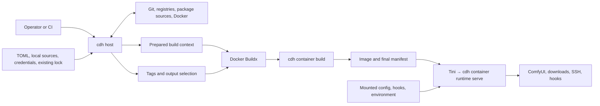

# Architecture

Use this map to find the owner of a change and understand the paths through host preparation, Docker build and container execution. [Contracts](contracts.md) defines the invariants to preserve; [Contributing](contributing.md) covers the development workflow.

## System context

One distribution provides the host CLI and the helpers installed into generated images:



Host commands run on the supported native platforms; container helpers execute only in the Linux image. Linux-only implementations stay outside the host import path. [Contributing](contributing.md#platform-compatibility) explains the platform development boundary.

Runtime deployment inputs can change application operation, but do not rebuild the image or re-enter host planning.

## Component responsibilities

| Component | Owns | Does not own |
| --- | --- | --- |
| [`config/`](../../src/comfyui_docker_helper/config/) | Authored/runtime models, merging, validation, planning and evidence schemas | Concrete external I/O orchestration |
| [`filesystem/`](../../src/comfyui_docker_helper/filesystem/) | Shared safe file/tree reads, bounded copying, cloning and platform primitives | Host or container workflow policy |
| [`host/`](../../src/comfyui_docker_helper/host/) | CLI composition, providers, credentials, lock/context preparation, canonical wheel, Buildx invocation | Image-internal execution |
| [`rendering/`](../../src/comfyui_docker_helper/rendering/) | Projection of an accepted BuildPlan and verified inputs into a build context | Resolution or a second planner |
| [`container/`](../../src/comfyui_docker_helper/container/) | Build helpers, final observation, runtime control and services | Host configuration or lock reconciliation |
| [`cli_output/`](../../src/comfyui_docker_helper/cli_output/) | Root detail settings, stream capabilities, safe text and event-sink primitives | Host/Container presentation or business policy |
| [`resources/`](../../src/comfyui_docker_helper/resources/) | Package-owned templates, release projection and runtime inputs | Deployment configuration |

Package-level modules provide shared identities and release/SSH input types. Keep a change at its narrow owner rather than introducing another cross-cutting orchestration layer.

## Dependency direction

Host orchestration calls shared configuration/planning code, supplies acquisition providers, then passes accepted inputs to rendering. Rendering depends on config-owned types and release inputs; it does not call providers or container services.

`filesystem/` is a shared foundation with no dependency back to those orchestrators. Within `config/`, validation, credentials and merge primitives support independent authored/runtime models; planning consumes authored configuration and evidence consumes planning results. Architecture tests enforce the exact forbidden imports.

Docker separates preparation from execution. The generated Dockerfile invokes `cdh container build` helpers; each receives only the admitted projection needed for its step. Container helpers do not reconstruct intent from host configuration or locks.

```text
effective configuration → request graph + admitted local inputs
  → accepted lock → BuildPlan → prepared context
  → image installation → final observation
```

Data does not flow backward from the manifest into resolution. See [planning contracts](contracts.md#planning-and-serialized-authority) for each artifact's authority and [context layout](contracts.md#rendered-context-layout) for its location.

## Main execution paths

| Operation | Path | Key boundary |
| --- | --- | --- |
| Validate | Load layers → merge → validate effective configuration | No providers, Docker, secret reads or file writes |
| Render | Resolve/admit inputs → reconcile lock → build plan → prepare private stage → publish or compare | Host owns publication; renderer does not resolve |
| Build | Prepare context → supply publication/credential/cache inputs → invoke Buildx → run helpers → observe final image | Buildx owns instruction execution; observation is downstream evidence |
| Run | Capture environment/config → start controller and logging → admit application lifecycle | Runtime configuration is separate from build planning |
| Restart | Controller accepts request → lifecycle stops old work → admits successor | One owner, serial replacement and no overlapping application generations |

These paths intentionally omit feature-specific rules. Local node filtering, credential grants, filesystem checks and replay limits belong in [Contracts](contracts.md), alongside the consequences of violating them.

## Where to start a change

| Change | Entry point | Read before editing |
| --- | --- | --- |
| Host preparation | [`host/context/service.py`](../../src/comfyui_docker_helper/host/context/service.py) | [Planning](contracts.md#planning-and-serialized-authority), [materialization](contracts.md#materialization-boundary) |
| Local file or node admission | [`local_inputs.py`](../../src/comfyui_docker_helper/host/context/local_inputs.py), [`local_nodes.py`](../../src/comfyui_docker_helper/host/context/local_nodes.py) | [Filesystem boundaries](contracts.md#host-local-filesystem-boundaries) |
| Dockerfile/context output | [`final_renderer.py`](../../src/comfyui_docker_helper/rendering/final_renderer.py), [`final_materializer.py`](../../src/comfyui_docker_helper/rendering/final_materializer.py) | [Materialization](contracts.md#materialization-boundary) |
| Image helper admission | [`container/build/admission.py`](../../src/comfyui_docker_helper/container/build/admission.py) | [BuildPlan](contracts.md#buildplan) |
| Final image evidence | [`manifest/observer.py`](../../src/comfyui_docker_helper/container/build/manifest/observer.py) | [Final observation](contracts.md#final-observation-and-replay-ceiling) |
| Runtime composition | [`runtime/serve.py`](../../src/comfyui_docker_helper/container/runtime/serve.py) | [Runtime boundaries](contracts.md#runtime-transfer-and-process-boundaries) |
| Restart or shutdown | [`runtime/controller.py`](../../src/comfyui_docker_helper/container/runtime/controller.py), [`runtime/lifecycle.py`](../../src/comfyui_docker_helper/container/runtime/lifecycle.py) | [Runtime control](contracts.md#runtime-control-has-one-owner-and-no-local-fallback), [shutdown](contracts.md#one-owner-and-one-monotonic-shutdown-timeline) |
| Downloads | [`transfer/core.py`](../../src/comfyui_docker_helper/container/transfer/core.py) | [Transfer ownership](contracts.md#transfer-policy-mechanism-and-state-have-different-owners) |
| CLI or runtime output | Shared `cli_output/` plus the owning Host/Container presenter | [Stream ownership](contracts.md#cli-observation-and-stream-ownership) |
